  

# Stefan Zhang · 张鹤扬

**Electronic Information Engineering undergraduate · Enrolled 2024**

Sichuan University – Pittsburgh Institute (SCUPI)

I work on 3D visual representations and build practical perception and AI tools. My interests span **3D reconstruction, robotics perception, multimodal sensor fusion, deep learning, and point cloud processing**.

[Email](mailto:bracket_x@163.com) · [Public repositories](https://github.com/bracketxzhy?tab=repositories)

## Research focus

- **3D computer vision:** monocular human reconstruction, mesh-bound Gaussian representations, and geometry processing.
- **Robotics perception:** local terrain reconstruction and complementary LiDAR / RGB-D observations.
- **AI engineering:** local inference, multimodal pipelines, and inspectable agent tools.

## Featured projects

### [Editable Gaussian Avatars](https://github.com/bracketxzhy/Editable-Gaussian-Avatars)

**3D reconstruction · Python / PyTorch · gsplat · SMPL / SMPL-X**

A monocular-video research pipeline that estimates body meshes, binds 3D Gaussians to a moving mesh sequence, and renders reconstructed avatars. It integrates SMPLest-X, MODNet, and gsplat; the current default configuration trains the **inner layer**. Outer-layer logic is experimental and is not a validated default result.

[Source and reproduction notes](https://github.com/bracketxzhy/Editable-Gaussian-Avatars#readme) · [Binding implementation](https://github.com/bracketxzhy/Editable-Gaussian-Avatars/tree/main/src/avatar_gs/gaussian/binding_layers)

### [Offline Smart Glasses](https://github.com/bracketxzhy/offline-smart-glasses)

**Computer vision · Python / C++ firmware · ONNX Runtime · OpenCV**

XIAO ESP32-S3 Sense captures images and audio; a local host handles detection, face recognition, visual questions, speech recognition, and spoken responses. The repository includes USB / Wi-Fi transport, a web console, and tests. Raspberry Pi migration is documented; hardware latency and wearable endurance still require validation.

View the documented vision pipeline

[Hardware and capture](https://github.com/bracketxzhy/offline-smart-glasses/tree/main/hardware/xiao-esp32s3) · [Deployment limits](https://github.com/bracketxzhy/offline-smart-glasses/blob/main/docs/raspberry-pi-migration.md)

### [Blackboard LMS MCP](https://github.com/bracketxzhy/blackboard-mcp-skill)

**Agent tools · TypeScript · Model Context Protocol · Zod**

A local stdio MCP server exposing eight read-only tools for courses, content, files, assignments, and deadlines. Uses individual login sessions, course membership checks, structured errors, and synthetic test fixtures. The tool API does not write grades.

[Tool definitions](https://github.com/bracketxzhy/blackboard-mcp-skill/blob/main/assets/server/src/tools/register.ts) · [Setup](https://github.com/bracketxzhy/blackboard-mcp-skill/blob/main/references/setup.md)

### [QQ → Google Calendar Workflow](https://github.com/bracketxzhy/qq-google-calendar-sync)

**Python · SQLite · Event processing · Agent integration**

A Windows workflow with allowlisted message ingestion, a local provenance ledger, human review, and an idempotent calendar-operation queue. Python manages state and validation; semantic analysis and Calendar writes require the user's configured Codex and Google Calendar connection.

[Workflow](https://github.com/bracketxzhy/qq-google-calendar-sync/blob/main/docs/WORKFLOW.md) · [Validation scope](https://github.com/bracketxzhy/qq-google-calendar-sync/blob/main/VALIDATION.md)

### [Sparse FFT](https://github.com/bracketxzhy/Sparse-FFT)

**Signal processing · MATLAB / Python · Course project**

An exploration of sparse Fourier recovery, with MATLAB modules and Python experiments for hashing, filtering, and reconstruction. The experiments illustrate algorithmic ideas; they are not an end-to-end runtime benchmark against FFT.

### [Antenna Pattern Fitting](https://github.com/bracketxzhy/3D_Gaussian_fitting)

**Scientific computing · NumPy / SciPy · Spherical harmonics**

Fits antenna radiation samples with spherical harmonics, applies a Gaussian-shaped envelope, visualizes the surface, and exports STL geometry.

## Ongoing research

**LRTTR — Multi-Sensor Terrain Reconstruction**

My current research focus is LiDAR / RGB-D fusion for local terrain reconstruction, including BEV representations and spatial / temporal modeling. This is ongoing work. A public implementation and reproducible results are not linked here yet.

## Research status & academic work

- **Editable Gaussian Avatars:** public research implementation in development.
- **Sparse FFT:** SCUPI ECE Analysis course project; the repository includes its course report and experiments.

## Technical skills

| Area | Evidence from public projects |
| :--- | :--- |
| Programming | Python, TypeScript; C++ coursework and ESP32 firmware; MATLAB |
| Deep learning & vision | PyTorch, gsplat, CUDA-backed rendering, OpenCV, ONNX Runtime |
| Perception & geometry | Monocular human reconstruction, mesh binding, face recognition, spherical harmonics |
| Engineering tools | Git, GitHub Actions, MCP, SQLite, local inference pipelines |

These are tools used in the linked work, rather than proficiency rankings. Robotics, sensor fusion, and point cloud processing are research interests; this profile does not imply a public deployment or benchmark for them.

## GitHub activity

  
  

Language statistics reflect repository contents, including dependencies; they do not measure expertise. Cards are generated daily and stored in this repository. The native contribution calendar appears below this README.

Cards generated with <a href="https://github.com/stats-organization/github-readme-stats-action">GitHub Readme Stats Action</a>.

## Contact

For research collaboration and internship enquiries: **[bracket_x@163.com](mailto:bracket_x@163.com)**.

