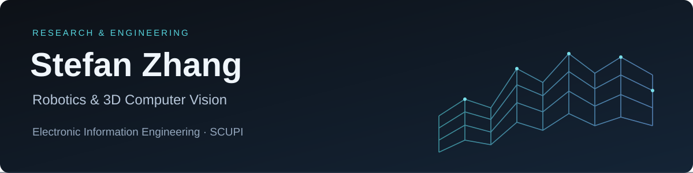

  

# Stefan Zhang

Electronic Information Engineering undergraduate at **Sichuan University – Pittsburgh Institute (SCUPI)**. Enrolled in 2024.

Interested in building practical perception systems and learning useful representations of the 3D world.

## Research Interests

3D Computer Vision · 3D Reconstruction · Robotics Perception  
Multimodal Sensor Fusion · Deep Learning · Point Cloud Processing

## Technical Toolkit

| Area | Tools |
| :--- | :--- |
| Programming | Python, TypeScript, C++, MATLAB |
| Vision & Learning | PyTorch, gsplat, OpenCV, ONNX Runtime |
| Engineering | Git, GitHub Actions, MCP, SQLite |

## GitHub Activity

  
  

Updated daily. Language statistics reflect repository contents, not proficiency. Generated with <a href="https://github.com/stats-organization/github-readme-stats-action">GitHub Readme Stats Action</a>.

## Contact

[Email](mailto:bracket_x@163.com) · [GitHub](https://github.com/bracketxzhy)
