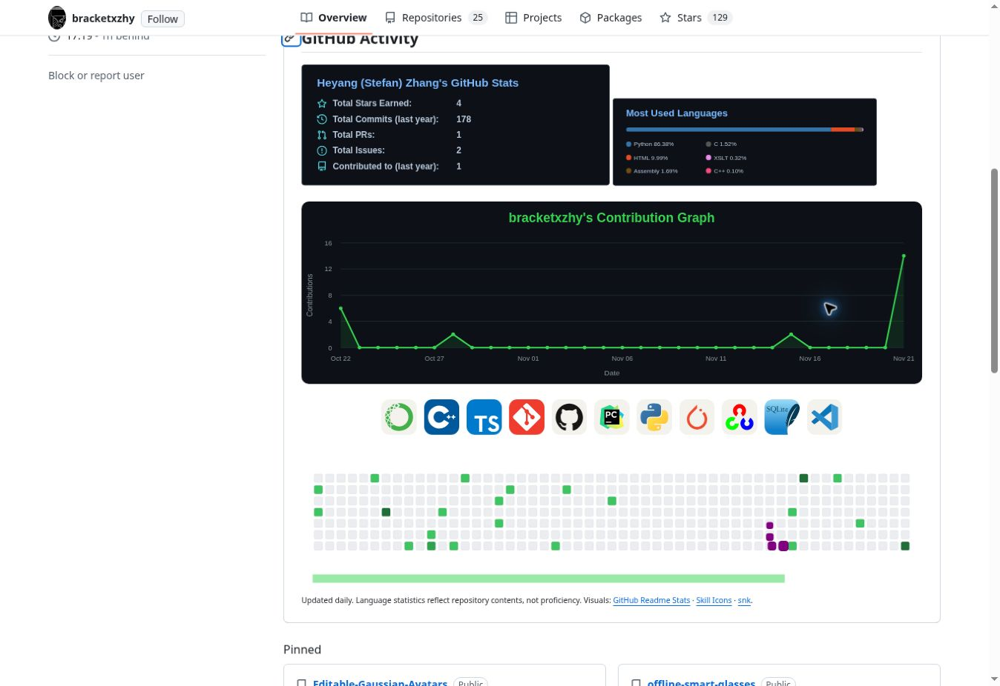

# Profile visual components

The layout follows the three adjacent sections in [TiramisuQiao's profile source](https://github.com/TiramisuQiao/TiramisuQiao/blob/main/README.md): a green contribution graph, a single row of tool icons, and a contribution snake. All contribution data belongs to `bracketxzhy`.

## Contribution graph

- `scripts/generate-contribution-graph.py` reads the unauthenticated public GitHub contribution calendar.
- It requires exact date/count labels and plots the latest 31 verified dates. Missing or unfamiliar labels fail generation rather than fabricate zero values.
- The green line and shaded area follow the reference's compact contribution-graph style.
- The current upstream Activity Graph documentation deprecates the Vercel URL in the reference. This implementation generates and commits the SVG directly, avoiding a viewer-time dependency on the shared graph service.
- Output: `assets/contribution-graph.svg`.

## Tool icons

The original SVG icons come from [tandpfun/skill-icons](https://github.com/tandpfun/skill-icons). Light and dark variants are combined into one local SVG row, with unique IDs to avoid gradient conflicts.

Shown: Anaconda, C++, TypeScript, Git, GitHub, PyCharm, Python, PyTorch, OpenCV, SQLite, and VS Code. These are tools used in the user's work, not proficiency rankings. The reference's unrelated icons are not copied as skill claims.

- `assets/tool-icons.svg`
- `assets/tool-icons-dark.svg`
- License: `assets/SKILL_ICONS_LICENSE.txt` (MIT, Copyright 2022 tandpfun).

## Contribution snake

The reference uses [Platane/snk](https://github.com/Platane/snk). This profile uses the same upstream SVG-only Action, pinned to `d8f6715049803e982ee5ff501b6b9b7d5deeb09b`.

- `assets/github-snake.svg`
- `assets/github-snake-dark.svg`
- Light/dark selection uses a native GitHub-supported `picture` element.
- No personal access token is needed; the existing repository-scoped `GITHUB_TOKEN` is used.

## Refresh and recovery

The existing `profile-cards.yml` refreshes statistics, the contribution graph, and both snake variants daily at 02:17 UTC (10:17 Asia/Shanghai), or on manual dispatch. It validates SVGs before committing and preserves the last published files if generation fails.

The original toolkit table is replaced with the icon row to avoid duplicate skill lists. The monochrome banner, Class of 2028, English-only text, and absence of project descriptions are preserved.

Backup branch: `backup/pre-contribution-visuals-2026-11-21`.

## Verified deployment

- [Workflow run 44888882450](https://github.com/bracketxzhy/bracketxzhy/actions/runs/44888882450) completed successfully: card generation, snake generation, public calendar rendering, SVG validation, and automatic commit.
- The final visitor page loaded all six displayed images (banner, two statistics cards, graph, tool row, and snake).
- Desktop viewport width and document scroll width both measured 1348 px, without horizontal overflow.
- Both snake files contain CSS keyframes; the live page displayed different snake positions across successive captures.
- The README still contains Class of 2028, English-only text, and no project descriptions.

